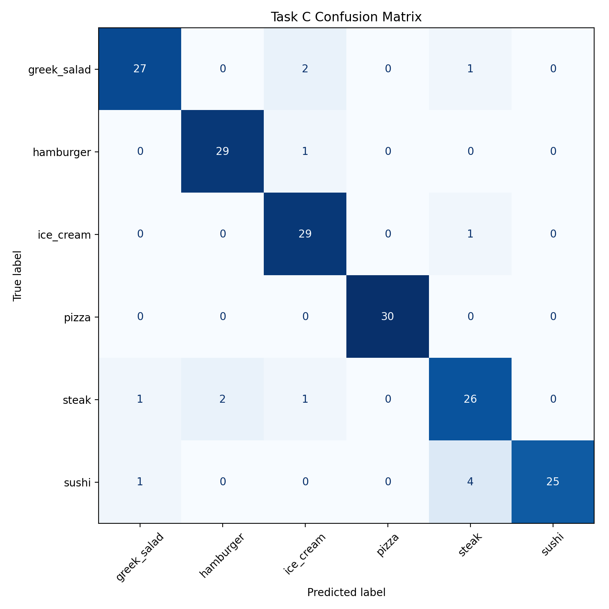

# Allergy-Aware AI Assistant

A command-line assistant that answers food-allergy questions. It combines four parts: AIML rules for dialogue, TF-IDF and SBERT retrieval for question answering, a first-order logic knowledge base that checks and learns facts, and a MobileNetV2 image classifier that recognises six dishes. When it is not confident, it declines and asks the user to rephrase instead of guessing.

This was my final-year AI module coursework at Nottingham Trent University (2026), graded First.

> Not medical advice. This is an educational project. Always check product labels and follow medical advice for allergies.

## Architecture

Every message goes to the AIML engine first. AIML handles small talk directly. For everything else it returns a command code (`#<code>$<args>`), and the Python controller in `src/chatbot.py` sends it to the right component.

```
user message
     │
     ▼
 AIML engine (kb/chatbot.aiml, 58 categories)
     │
     ├── plain reply ───────────────────────────────► small talk, greetings
     │
     ├── #99  question ──► QA retrieval ────────────► answer, or "not confident"
     │                     TF-IDF or SBERT + thresholds
     │
     ├── #41  "I know that X is Y" ──► logic engine ─► add fact if consistent
     ├── #42  "Check that X is Y"  ──► logic engine ─► Correct / Incorrect / Don't know
     │                     NLTK resolution prover        + explanation
     │
     ├── #51  "What food is this" ──► MobileNetV2 ──► dish + confidence + label warning
     ├── #52 / #53 ──► Google Cloud Vision ─────────► second opinion / side-by-side
     │
     └── #1   "What is X" ──► Wikipedia summary
```

| Path | Contents |
|---|---|
| `src/chatbot.py` | Controller: loads every component and routes commands |
| `src/logic_engine.py` | First-order logic knowledge base, consistency checks, explanations |
| `src/image_model/` | Training, local inference and the Cloud Vision comparison |
| `kb/` | AIML rules, 60 QA pairs, 37 logic statements |
| `eval/` | Labelled evaluation sets and the scripts that score them |
| `results/` | Saved outputs that every number below comes from |
| `data/` | Image dataset instructions (images are not committed) |

## Results

### Food image classifier (6 classes, 180 held-out test images)

From `results/training_metrics.txt`. I loaded the saved model again with `eval/evaluate_task_c.py` and got the same numbers (`results/task_c_reeval_output.txt`).

| | Value |
|---|---|
| Test accuracy | **92.22%** (166 / 180) |
| Macro F1 | **0.9224** |

| Class | Precision | Recall | F1 |
|---|---|---|---|
| greek_salad | 0.9310 | 0.9000 | 0.9153 |
| hamburger | 0.9355 | 0.9667 | 0.9508 |
| ice_cream | 0.8788 | 0.9667 | 0.9206 |
| pizza | 1.0000 | 1.0000 | 1.0000 |
| steak | 0.8125 | 0.8667 | 0.8387 |
| sushi | 1.0000 | 0.8333 | 0.9091 |

Steak is the weakest class. The most common error is sushi predicted as steak (4 of 30 sushi images).



### Question answering refusal behaviour

From `results/task_a_eval_output.txt`. The labelled set has 49 queries, each marked ANSWER (44) or REFUSE (5). A run counts as correct when the bot answers or refuses as labelled.

| Mode | Threshold | Correct behaviour |
|---|---|---|
| TF-IDF baseline | 0.35 | 49 / 49 |
| SBERT (`all-MiniLM-L6-v2`) | 0.55 | 49 / 49 |

The thresholds were picked by hand while checking this set. No automated threshold sweep was saved. Only 5 of the queries should be refused, so this checks that the guardrails work. It does not measure refusal accuracy in general.

### Logic reasoning

From `results/task_b_eval_output.txt`: **30 / 30** cases pass. They cover direct facts, multi-step derivations, unknowns, adding a consistent fact and rejecting a contradictory one.

### Google Cloud Vision comparison

`#52` and `#53` send the same image to Google Cloud Vision. They map its labels onto the six classes and show the result next to the local model's. No results from this comparison were saved, so no figures are reported here. To run it yourself, set up credentials (see below) and run `python eval/test_task_c_cloud.py`.

## Example conversation

This is a real run of `src/chatbot.py`, with startup log lines removed:

```
> Hello
Hello! How are you?
> Is butter dairy free
No. Butter is made from milk, so it contains dairy. For dairy‑free cooking, use plant‑based butter or oils, and always check labels for hidden milk ingredients.
> Is plastic dairy free
I’m not confident about that. Could you rephrase using the ingredient/food name? Also check the product label to be safe.
> Substitute for eggs
For baking: flax/chia ‘egg’ (1 tbsp ground flax/chia + 3 tbsp water), commercial egg replacer, aquafaba (chickpea water), or mashed banana/applesauce (changes flavour).
> Check that butter is unsafe for milk allergy
Correct.
Butter is unsafe for milk allergy because it is dairy, dairy items are not dairy-free, and items that are not dairy-free are unsafe for milk allergy.
> Check that rice milk is dairy free
Sorry, I don't know.
Neither 'DairyFree(rice_milk)' nor its negation can be proved from the knowledge base.
> I know that butter is vegan
Sorry. That would contradict what I already know.
> I know that oat milk is dairy free
OK. I have added 'DairyFree(oat_milk)' to the knowledge base.
> Check that oat milk is dairy free
Correct.
The statement 'DairyFree(oat_milk)' is directly stored in the knowledge base.
> Bye
Bye! Nice talking to you. You take care now.
```

Typing "What food is this" opens a file picker and classifies the chosen photo. The picker can't be scripted, so here is the same classifier run on the demo images by `eval/test_task_c.py` (`results/task_c_sample_output.txt`):

```
hamburger_demo.jpg -> hamburger (98.47%)
steak_demo2.jpg -> steak (77.46%)
sushi_demo.jpg -> sushi (99.86%)
```

## How to run

Tested with Python 3.12 on Windows 11.

```bash
python -m venv .venv
.venv\Scripts\activate          # macOS/Linux: source .venv/bin/activate
pip install -r requirements.txt
python scripts/setup_nltk.py    # downloads NLTK data into ./nltk_data
```

**Model weights.** Download `food_classifier.h5` from this repo's [Releases](../../releases) page and put it in `models/`. You only need it for image classification.

**Run the assistant** from the repo root:

```bash
python src/chatbot.py
```

Type `MODE TFIDF` or `MODE SBERT` to switch retrieval method while it runs.

**Run the evaluations:**

```bash
python eval/test_task_a.py        # QA answer/refuse behaviour, TF-IDF and SBERT
python eval/test_task_b.py        # logic engine, 30 cases
python eval/evaluate_task_c.py    # needs the weights and data/task_c_dataset/test
python eval/test_task_c.py        # demo images in data/task_c_sample_images/
```

**Dataset.** See [data/README.md](data/README.md). It lists the Food-101 source and licence, and `data/split_manifest.csv` gives the exact train/val/test split. Retrain with `python src/image_model/train_task_c.py`.

**Google Cloud Vision (optional).** Only commands `#52` and `#53` need it. Sign in with `gcloud auth application-default login`, or set `GOOGLE_APPLICATION_CREDENTIALS` to a key file stored outside the repo (see `.env.example`). The code contains no keys.

On Windows, set `PYTHONIOENCODING=utf-8` if you redirect output to a file. Some answers contain non-ASCII hyphens.

## Design decisions

- **It refuses below a confidence threshold.** A wrong allergy answer can hurt someone, so the bot only answers when three checks pass. The similarity score must be above the threshold. The query and the matched question must share at least one meaningful word. The query must not contain an obvious non-food word, such as "plastic".
- **It keeps TF-IDF as a baseline next to SBERT.** You can switch between them while the bot runs, and both are scored on the same labelled set. That way the gain from embeddings can be compared directly.
- **Facts are added only if they are consistent.** "I know that X is Y" first asks the resolution prover whether the negation can be proved. It then runs domain checks (for example, something vegan can't be dairy). Without this, a user could teach the bot that butter is vegan, which would be unsafe.
- **There are three answers, not two.** "Check that" returns Correct, Incorrect or Don't know. A fact the knowledge base can't prove is reported as unknown, not as false.
- **The image model uses transfer learning.** MobileNetV2 with a frozen ImageNet base and a small head reaches 92% with only 200 training images per class.

## Limitations

- **The image model is small.** It has 6 classes and 1,680 images, so it can't recognise any other dish. It also names the dish, not the ingredients, so it can't tell you whether a particular burger contains sesame.
- **The question bank is small.** 60 hand-written QA pairs. Anything outside them is refused.
- **The QA evaluation set is small and uneven.** 49 queries, only 5 of which should be refused. The thresholds were tuned on this same set, so 49/49 is not a held-out score.
- **The logic knowledge base is small.** 37 statements. Facts taught during a session are lost when the bot restarts.
- **No Cloud Vision benchmark numbers were recorded.**
- **This is not medical advice.**

## Credits

- `src/chatbot.py` and `kb/chatbot.aiml` started from AIML chatbot starter code provided by the Nottingham Trent University module: the basic input loop and the `#0`/`#1` command convention. All allergy, QA, logic and vision components are my own work.
- Food-101 dataset: Bossard, Guillaumin and Van Gool, ECCV 2014.
- SBERT model `all-MiniLM-L6-v2` from sentence-transformers.

## Licence

MIT. See [LICENSE](LICENSE). The licence covers the code only. The Food-101 images keep their own terms.
